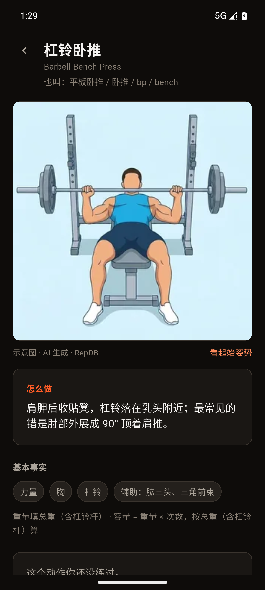
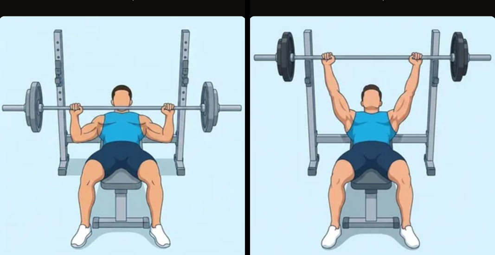
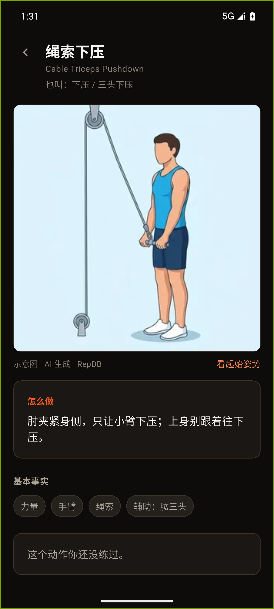

# 接入 RepDB 动作插图（2026-10-11）

> 上游依据：`docs/exercise-art-survey-2026-10-11.md`（素材调研，结论"能用/不能用"的清单）。
> 那份的结论是"先上文字要领 → 下一步接 RepDB"；**这份记的是"接"这件事本身**：
> 匹配怎么做的、哪些动作**故意不配图**、许可义务落在哪、以及还没验的部分。

---

## 一、一句话结论

351 个动作里 **226 个配上了 RepDB 的免费档示意图**（覆盖率 64.4%），
426 张 320px WebP、合计 **2.77 MB**，全部随包离线可用，零网络请求。
**其余 125 个动作有意不配图** —— 宁缺勿错配（见 §三）。

---

## 二、匹配是怎么做的（可复现）

唯一真源是 **`tool/repdb-art-map.tsv`**（人工维护的 `我们的动作id → RepDB动作id` 对照表，
每条带来源与中文理由）。它由 `tool/vendor-repdb-art.mjs` 消费，生成
`app/assets/repdb-art.json`（清单）与 `app/assets/repdb-art/*.webp`（图片副本）。

三轮匹配，每一轮都比上一轮收得更紧：

| 轮次 | 办法 | 结果 | 落在哪 |
|---|---|---|---|
| 1 | 英文名 / 别名**逐字**相同（归一化后） | 143 条 | 来源 `exact` |
| 2 | 机器相似度候选（Jaccard + 器械加权 + 部位加权） | 当初给 19 条，复核后**只留 13 条** | 来源 `auto` |
| 3 | 人工逐条判读（189 条候选，能否接受靠"是不是同一个动作"） | 75 条接受 → 我复核后**只留 70 条** | 来源 `review` |

**机器那一轮不可信，这是这次最值得记的教训**：它的排序是噪声。
例：`Close-Grip Dumbbell Press` 真身 `close-grip-db-bench-press` 排第 3（0.80），
而一个地板卧推排第 1（0.90）；`cable-fly` 被分给了**上斜**绳索飞鸟而不是最普通的站姿绳索夹胸。
所以我逐条复核了它的 19 条，**推翻 6 条**：

| 被推翻的配对 | 为什么错 |
|---|---|
| `ex_bb_ohp` → `bodyweight-overhead-press` | 我们的是**杠铃**站姿推举，对方是自重/弹力带的 |
| `ex_single_arm_db_press` → `one-arm-dumbbell-push-press` | push press ≠ press（借力与不借力是两个动作） |
| `ex_standing_dumbbell_press` → `dumbbell-push-press` | 同上 |
| `ex_db_decline_press` → `db-svend-press` | 斯万德夹胸是"合掌挤"，不是卧推 |
| `ex_incline_cable_fly` → `cable-fly` | 上斜飞鸟占用了通用飞鸟 —— 改判给 `ex_cable_crossover`（最普通的那个） |
| `ex_bb_floor_press` → `floor-press` | 对方的 `floor-press` 是杠铃的，**这条留着**（表里仍在） |

---

## 三、125 个动作**故意**不配图（不是漏了）

匹配规则只有一条："**这张图画的就是我们写的那个动作**"。四条不许凑：

* **器械不许凑**：`machine ≠ barbell`、`smith ≠ barbell`、`cable ≠ machine`；
* **不借力 ≠ 借力**：push press / push jerk 都不算 press；
* **静力 ≠ 动态**：hold / stretch 的图不能配给一次动态发力；
* **姿势与握距不许默认**：没写"上斜"的图不能配给上斜动作，没写"反握"的不能配给反握。

按这条筛下去，125 个动作在 RepDB 里**真的没有对应动作**，主要是：
器械/上斜/单臂的变体组合、整批弹力带动作、静力保持（负重平板、L 坐、超人式保持）、
以及我们独有的少数动作。

另有 **5 条是"有人配了、我复核时推翻"** 的（复核表格里判 ACCEPT，我改判不配）：

| 动作 | 被推翻的图 | 理由 |
|---|---|---|
| `ex_wide_t_bar_row` | `t-bar-row` | 已经是 `ex_t_bar_row` 的图；一张图不能配两个动作，宽握那条让位 |
| `ex_heel_elevated_goblet_squat` | `heel-elevated-squat` | 对方是**杠铃**垫脚跟深蹲，我们的是哑铃高脚杯 |
| `ex_decline_sit_up` | `decline-crunch` | 下斜**仰卧起坐**（屈髋）≠ 下斜卷腹（只屈腹） |
| `ex_single_arm_dumbbell_tricep_extension` | `single-arm-dumbbell-overhead-tricep-extension` | 我们没写明"颈后"，就不能套那张"颈后"图 |
| `ex_weighted_russian_twist` | `kettlebell-russian-twist` | 哑铃负重 ≠ 壶铃负重 |

---

## 四、产物与体积

| 项 | 值 |
|---|---|
| 匹配动作 | 226 / 351（64.4%） |
| 图片张数 | 426（**200 个动作有 start+peak 两张**，26 个只有一张 —— 拉伸/静力类） |
| 尺寸 | **320×320 WebP**（源是 512px；详情页最大画到 ~160pt，320 在 2× 屏上够） |
| 体积 | **2.77 MB**（预算 6 MB，守卫盯着） |
| RepDB 快照 | `2026-10-08`（写在清单的 `source_snapshot` 里） |

**为什么整批打包而不是按需下载**：健身房常常在地下室没信号，而"这个动作怎么做"
恰恰是那一刻最需要的东西。2.77 MB 换完全离线可用，划算。

---

## 五、界面落在哪

| 位置 | 内容 |
|---|---|
| 动作详情页（`exercise_detail_screen.dart`） | 「怎么做」卡片**上方**一张方形插图；有 start/peak 两张时右下角一个「看起始姿势 / 看顶峰姿势」切换 |
| 图下方一行 | 「示意图 · AI 生成 · RepDB」—— **两个信息**：出处，以及这是 AI 生成内容 |
| 训练屏 | **不插图**。那一屏的语言是"大字 + 大按钮 + 细线"，插一张图会把"记一组"这个动作挤掉；要领文字已经在那里了 |
| 「我」→「隐私与关于」→「动作插图来源」 | 署名页：逐字署名、可复制地址、许可摘要三条、AI 生成说明 |

**为什么详情页图下方要写"AI 生成"**：这些图是 RepDB 用 AI 工具生成后挑选的
（许可原文 "Origin of the data" 一节写明）。国内《人工智能生成合成内容标识办法》
2025-09-01 生效，要求对 AI 生成内容作出标识。这不是排版偏好，是合规动作。

---

## 六、许可义务（**每一条都有一条机械检查盯着**）

RepDB Free Tier License v1.0，原文副本 `tool/repdb-license.txt`（GitHub 那份，
比官网 ZIP 里的 `LICENSE.md` 多一条"付费档预览仅限评估"）。

| 义务 / 禁令 | 我们怎么履行 | 谁盯着 |
|---|---|---|
| ① **可见署名**「Exercise data by RepDB (repdb.co)」 | 署名页逐字写着，入口在「隐私与关于」菜单里 | `check-repdb-art.mjs` + `repdb_art_test.dart` |
| ② 只在**应用内**用，不得作为数据集/API 再分发 | 不做"导出图库"这类功能；图只随端走 | 人工（本条没有机械判据，如实记） |
| ③ 保留许可与出处记录 | `tool/repdb-license.txt` + 清单里的 `source`/`license`/`attribution` | `check-repdb-art.mjs` |
| ④ 不得作为生成式 AI 的输入/参考/训练素材 | 我们没做这件事（没有图生图，也没有拿它微调） | 人工 —— 见 §八"没法机械验证的" |
| ⑤ **付费档预览图一字节都不许进包** | 资产目录里只有免费档 `images/flat` 的重编码；文件名/清单里出现 `premium`/`sample` 就红 | `check-repdb-art.mjs` + `vendor-repdb-art.mjs --check` + Dart 测试 |
| ⑥ 不得去掉署名、不得声称是自己的作品 | 署名页与清单都写明出处；图片文件名带 RepDB 的 id | 同上 |
| ⑦ 允许缩放/改色（第 4 条） | 我们只做了缩放（512 → 320），没改色 | — |

三处守卫（都进了 `verify.sh`）：

* `tool/vendor-repdb-art.mjs --check` —— 清单 ↔ 实物（张数、尺寸、体积、有没有多出来的图）；
  它由下面那个守卫代跑，**不单独进 CI**：生成才需要 Pillow，核对不需要（CI 上没有 Pillow）。
* `tool/check-repdb-art.mjs` —— 署名、入口、许可原文、付费档边界、pubspec 声明；
  8 条自检（署名被删/入口被摘/许可被换/生成脚本署名漂了/付费预览混入/pubspec 漏声明…）。
* `app/test/repdb_art_test.dart` —— 10 条：清单自洽 + **每个路径真的存在** +
  逐字署名 + 坏数据降级不抛 + 有图就画/没图不画空框 + 文件缺失不白屏 +
  资产目录里没有付费档图 + 体积在预算内 + 占位图标走语义表。

---

## 七、判据与现状（如实记）

| 判据 | 现状 |
|---|---|
| 清单与实物一致（张数/尺寸/体积） | ✅ 426 张 / 320×320 / 2.77 MB |
| 每个清单路径在文件系统里存在 | ✅ 测试扫过 |
| 署名逐字，且能从菜单点进去 | ✅ 守卫扫过 |
| 资产目录/清单里没有付费档预览 | ✅ 三条守卫都扫 |
| 详情页有插图时画图、没图时不画空框 | ✅ widget 测试 |
| 图片文件缺失时不白屏 | ✅ widget 测试（走占位图形） |
| 大字号不溢出（1.5× / 2.0×） | ✅ 已把「动作详情页（有插图）」「动作插图来源」两屏加进 `large_font_sweep_test`（共 22 屏 × 2 档） |
| **模拟器上看得对不对** | ✅ **2026-10-12 验过**（`emulator-5554`，1080×2400 @440dpi ≈ 393dp 宽，release 包 v1.67.0+82 带着插图）：详情页插图正常渲染、切换姿势真的换图、`做法` 卡片排在图下方、冷启动 0 条 `E/flutter` / 0 条 `overflowed`。证据三张见 `docs/images/repdb-art-2026-10-12/`（含张开/顶峰两张对比） |
| **真机上看得对不对** | ⛔ **还没验**（iPhone 18 Pro 的 UDID 不在开发描述文件里，见 §八 1） |

---

## 八、还没做 / 只有人能验的

### 1. 真机安装：iPhone 18 Pro 卡在"设备没进描述文件"（2026-10-12）

用户点单「装真机看一下」后的实测状态，**如实记**（这不是产品缺陷，是签名前提）：

* **iPhone 18 Pro**（`00008160-000609EE0A08000A`，iPhone19,2）：`devicectl` 读到 `connected / paired ✓`，
  但本地三份描述文件（`com.sdknwdtvpv.lianleme.dev`、`.RestWidget`、`work.elliot.yuanxu`）
  **都不含它的 UDID**，所以 `xcodebuild` 报
  `Provisioning profile … doesn't include the currently selected device`；
* 而 `-allowProvisioningUpdates -allowProvisioningDeviceRegistration` 那两个开关**没能救回来**，
  因为同时报 **`No Accounts: Add a new account in Accounts settings.`** ——
  实测 Xcode 的账号列表**是空的**：
  `defaults read com.apple.dt.Xcode DVTDeveloperAccountManagerAppleIDLists` →
  `{"IDE.Identifiers.Prod" = ()}`。上一次（2026-10-09）同一个症状也是靠**在 Xcode 里重新登录
  那个 Apple ID**解决的（见 `docs/ios-free-provisioning-guide.md` §四）。
* **iPhone 17 Pro**（`00008150-000949CA0108401C`）：描述文件**含它**（三份都含），
  但它现在 `unavailable`（没插线/没开无线调试）——**插上线就能装，不需要动账号**。
* 结论：要装 iPhone 18 Pro 需要**你在 Xcode → Settings → Accounts 重新登录 Apple ID**，
  之后本脚本会自动注册设备 + 建描述文件；想省这一步就插 iPhone 17 Pro。

### 2. 只有眼睛能判的三件

**模拟器给不了答案**（屏密度与观感不同），必须在真机上看：
320px 在 3× 屏上会不会发虚；深色页面上浅底方图的观感；切换姿势那一下会不会觉得多余。

### 3. 其余

4. **许可第 ④ 条（不得喂模型）没有机械判据**。它是"我们没做这件事"的承诺，
   不是代码状态 —— 所以记在这里，而不是假装有守卫。将来若有人把动作图拿去做
   img2img / 风格迁移 / 微调，**门禁不会红**，只有这段文字会提醒。
5. **上游会更新**：RepDB 的快照是 2026-10-08（637 个动作）。他们加动作之后，
   我们可以重跑匹配把覆盖率往上抬（现在的 125 个"无对应动作"是**那天**的事实）。
6. **署名义务不止在 App 内**：许可说"App 的关于/致谢页、项目 README、或网站页脚"三处**任一**即可，
   我们做了 App 内那处。若将来做官网，那一处也该写上（成本一行字）。
7. **AI 标识的措辞**还没经合规确认：现在写在图下方一行与署名页一段。
   若国内应用商店审核提出更具体的标识要求（位置/字号/文案），按他们的来。

---

## 九、验证证据（模拟器，2026-10-12）

| 图 | 看什么 |
|---|---|
|  | 插图渲染、图下「示意图 · AI 生成 · RepDB」、「怎么做」在下方 |
|  | 左 = 默认（顶峰：杠在锁骨上方）／右 = 点「看起始姿势」后（起始：杠在胸口），**真的换了图** |
|  | 另一个动作（绳索下压）：图与动作对得上（高位滑轮 + 绳索下压） |

